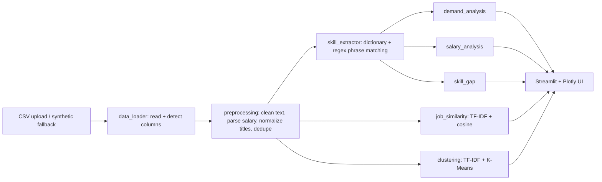

# Methodology

## Architecture

## Data flow
Raw DataFrame (never modified) -> `clean_dataframe` creates a new table (title, description, skills_text, location,
salary_annual, currency, date, title_family, text) -> `process` adds `skills` (list) -> every analytics module reads the cleaned table.

## Algorithms
- **Text cleaning:** lowercase, HTML unescape, tag/URL removal, whitespace collapse.
- **Skill extraction:** each skill compiles to one regex of its canonical name + aliases, longest first, with boundaries
  `(?<![a-z0-9+#])...(?![a-z0-9+#])` so `java` != `javascript` and `c++`, `node.js`, `ci/cd` work.
- **Demand %:** `postings mentioning skill / postings in selection x 100`.
- **Salary parsing:** detects currency (INR/USD/GBP/EUR) and period; hourly x2080, weekly x52, monthly x12; range -> midpoint;
  no period -> assumed annual; non-positive/absurd values -> missing. No FX conversion; stats computed per currency (min n=3).
- **Skill gap:** target = top-N skills for the role with demand >= 5%. Missing skill priority: High >= 50%, Medium 25-50%, Low < 25%.
  Coverage = sum(demand of matched) / sum(demand of target) x 100. Rationale text quotes real counts.
- **Similarity:** `TfidfVectorizer(stop_words='english', ngram_range=(1,2), sublinear_tf=True)`; score = cosine(query, posting).
  Measures wording overlap only.
- **Clustering:** TF-IDF (max 2000 features, min_df=2) -> `KMeans(n_init=10, random_state=42)`; k in 2..8 chosen by highest silhouette;
  2-D view by TruncatedSVD. Skipped when < 30 postings or vocabulary too small.
- **Reproducibility:** `RANDOM_SEED = 42` in `src/config.py`.

## Evaluation
40 pytest tests: cleaning, parsing, edge cases (empty data, missing columns, invalid salaries), extraction correctness,
gap arithmetic, similarity ordering, clustering reproducibility and skip behaviour. Clustering uses silhouette (-1..1).
Nothing here is a supervised classifier, so accuracy/precision/recall/F1 are intentionally not reported.

## Limitations
1. Dictionary extraction misses unlisted skills, ignores "required vs preferred" and negation; short tokens like "go"/"r" are risky.
2. Findings reflect only the uploaded dataset's sampling biases (platform, country, time).
3. Titles are normalized by regex rules; unusual titles fall into "other" families.
4. Salary: assumed-annual fallback, no inflation/FX handling; skill-salary gaps are confounded by role.
5. Synthetic data has built-in role-skill structure, so its results are artefacts of the generator.
6. TF-IDF ignores meaning (synonyms, context); K-Means assumes roughly spherical clusters.

## Future scope
Embedding-based extraction (spaCy/sentence-transformers), supervised salary regression with proper train/test split and MAE/R²,
resume PDF parsing, live data ingestion with permission, time-series trend forecasting.
